# Mapa: antes y después del estilo de bloques

Fotos del 2026-10-20 desde los mismos 16 ángulos (misma cámara, campo vertical de 70°).

- **antes/**: el juego actual en Studio (Play, mediodía, sin evento, efectos completos).
- **despues/**: render de Blender del mapa nuevo, todavía sin incorporar al juego: isla y
  volcán de bloques (modelos de los agentes), decoración de bloques (`tools/blender/props_bloques.py`)
  y las construcciones de `world/Isla.model.json`. El volcán está separado de la isla
  (centro del cráter en z = 722 en vez de 520), así que las tomas del cráter cambian de lugar.
- **comparacion/**: las dos lado a lado.

El agua, la luz y la cueva de los renders son de referencia: en el juego los da Roblox.

### Aerea sur
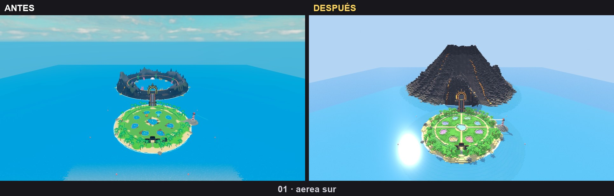

### Aerea este
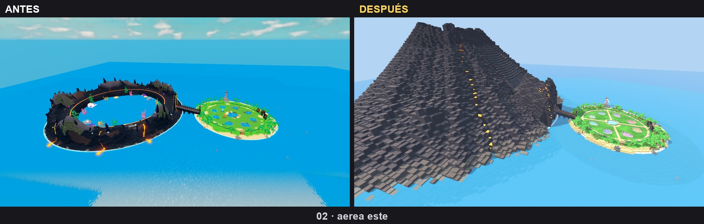

### Aerea oeste
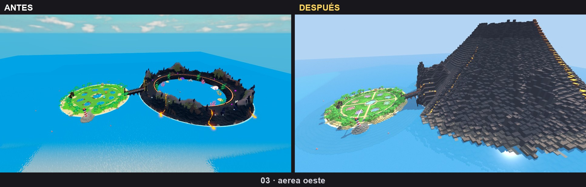

### Aerea norte
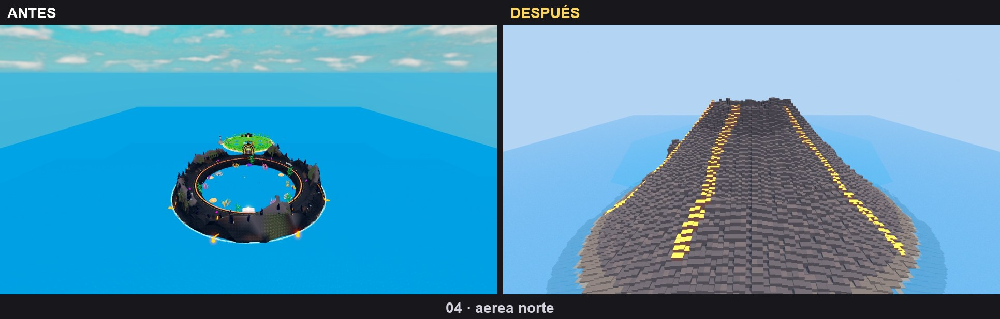

### Cenital
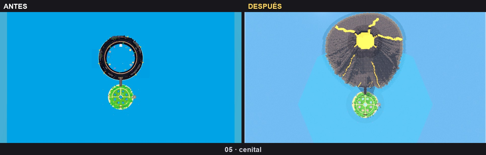

### Plaza desde la aparicion
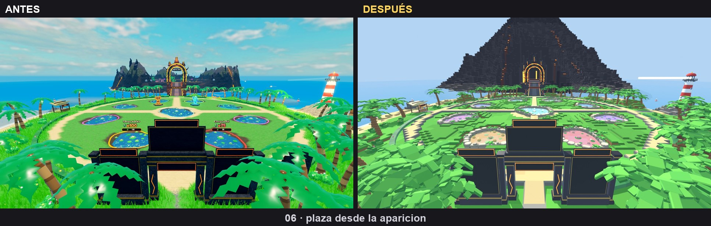

### Plaza hacia el volcan
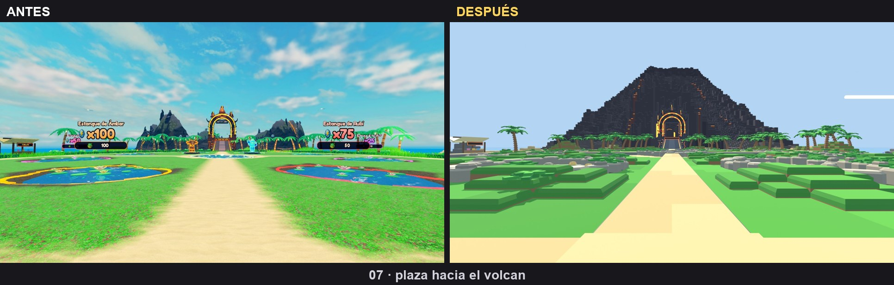

### Plaza desde arriba
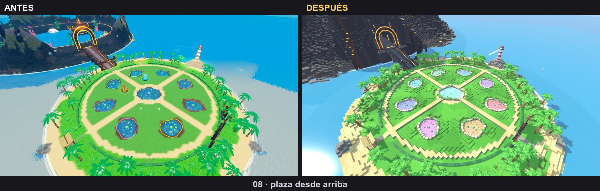

### Estanque
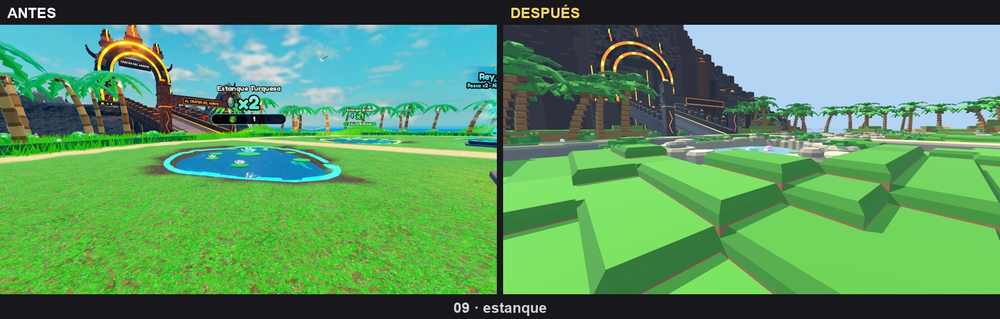

### Estanque sagrado
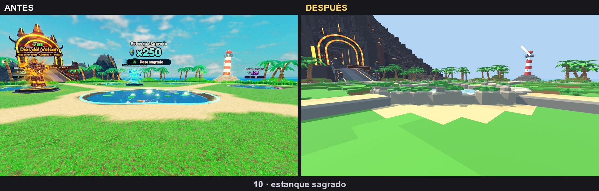

### Playa
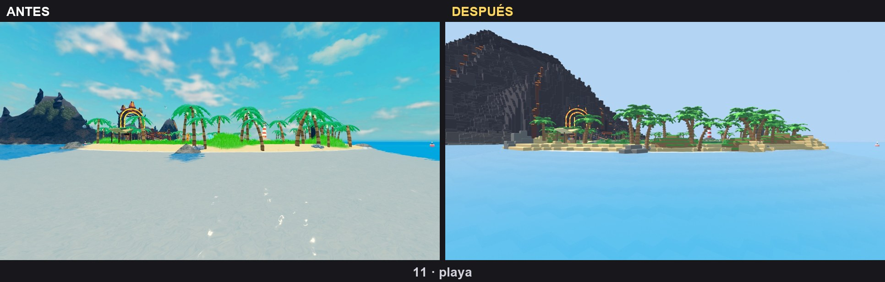

### Faro y costa
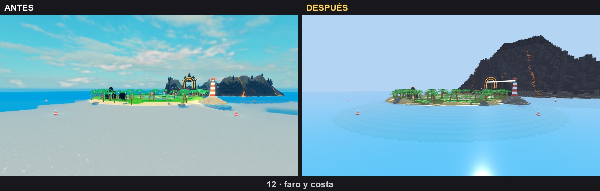

### Puente hacia el arco
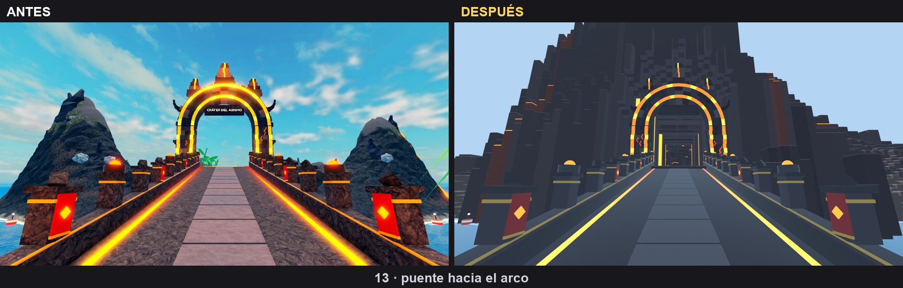

### Volcan desde el mar
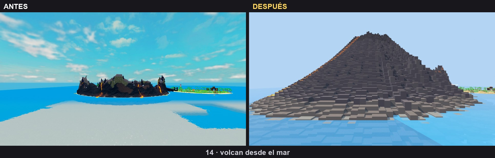

### Paseo del crater
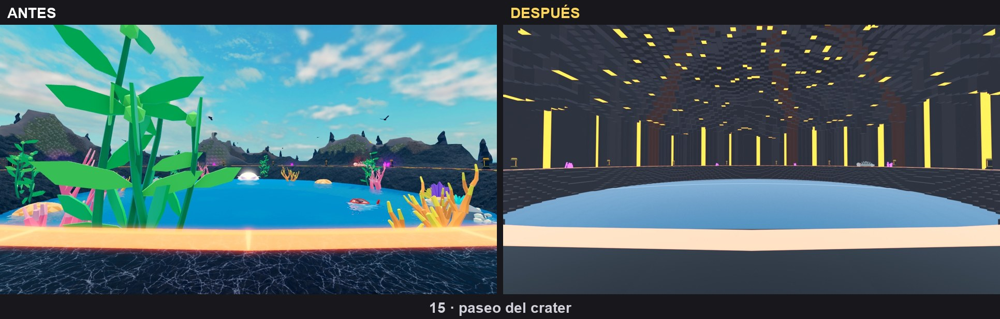

### Lago del gigante
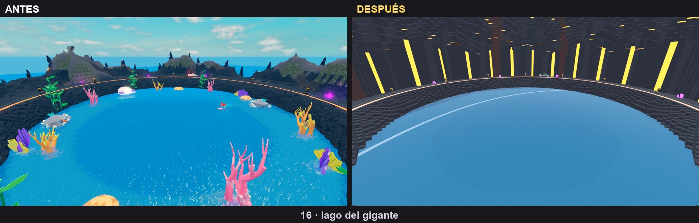
